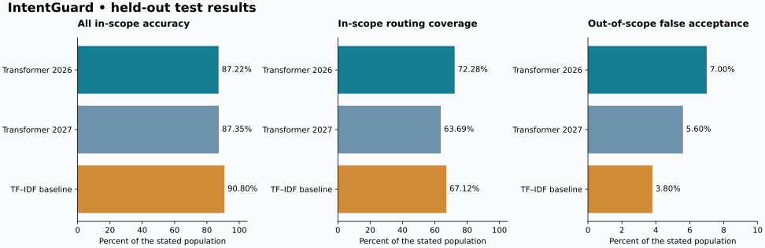
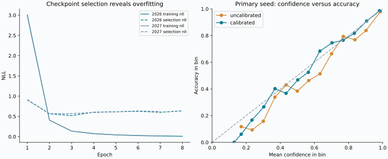
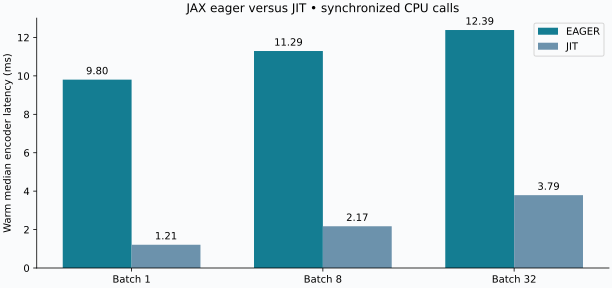

# IntentGuard JAX

**A small Transformer that routes supported requests and exposes when it should abstain.**

[](https://github.com/dimxxkun/intentguard-jax/actions/workflows/ci.yml)
[](LICENSE)

IntentGuard is a reproducible NLP experiment and local inference service built with **JAX, Flax NNX, Optax, Hugging Face Transformers, and FastAPI**. A 560,598-parameter encoder learns 150 conversational intents from scratch. Temperature scaling, split-conformal prediction sets, and a separately fitted acceptance policy turn its scores into an explicit route-or-abstain response.

The project investigates a practical question: **how much useful traffic can a compact classifier accept while limiting unsupported requests?** It includes two real training runs, a competitive lexical baseline, retained evaluation evidence, and synchronized CPU benchmarks.

**The baseline wins on overall classification accuracy.** The primary Transformer accepts more in-scope requests, but makes more routing errors. Those tradeoffs are part of the result.



## What is implemented

- **Transformer training:** pre-norm attention blocks, masked mean pooling, explicit PRNG keys, AdamW, gradient clipping, warmup/cosine decay, early stopping, and zero-weight padding of partial batches.
- **Data discipline:** pinned CLINC150 source and checksum, canonical duplicate quarantine, train-only WordPiece vocabulary, and disjoint selection, temperature, conformal, policy, and test roles.
- **Uncertainty:** stable logit calculations, temperature fitting with SciPy, finite-sample conformal quantiles, and an empirical out-of-scope acceptance constraint.
- **Evaluation:** accuracy, macro F1, NLL, ECE, Brier score, OOS AUROC/AP, prediction-set coverage, routing coverage, accepted-request accuracy, and traceable error IDs.
- **Serving:** verified safetensors bundles, local CLI, typed FastAPI requests, bounded batches, explicit truncation flags, and a busy response instead of concurrent model calls.
- **Performance evidence:** eager/JIT parity, fresh worker processes, cold and warm timings, raw repetitions, sampled memory, and environment metadata.

The encoder and optimizer run in JAX/Flax; **PyTorch is not required**. Transformers supplies its tokenizer interface, with the Rust Tokenizers library training WordPiece. NumPy remains a host-array dependency and scikit-learn supplies the baseline. Transformers v5 retired its Flax model backend, so this project owns its Flax encoder directly ([upstream announcement](https://huggingface.co/blog/transformers-v5)).

## Measured results

Test population: **4,498 in-scope examples and 1,000 out-of-scope examples**, after the documented duplicate audit. Seed 2026 was designated as the primary run before test evaluation. Both Transformer seeds share one train-only tokenizer.

| Model | All in-scope accuracy | Macro F1 | In-scope accepted | Accuracy among accepted in-scope | OOS falsely accepted |
|---|---:|---:|---:|---:|---:|
| Transformer, seed 2026 | 87.22% | 0.8715 | 72.28% | 97.88% | 7.00% |
| Transformer, seed 2027 | 87.35% | 0.8713 | 63.69% | 98.57% | 5.60% |
| TF-IDF + logistic regression | **90.80%** | **0.9071** | 67.12% | **99.01%** | **3.80%** |

“Accepted accuracy” excludes both rejected requests and OOS requests; it is **not overall model accuracy**. For the primary model, 3,251 of 4,498 in-scope requests were accepted, and 3,182 of those were correct. It also incorrectly accepted 70 OOS requests.

The rejection policy allowed at most 5% false acceptance on its **100-example OOS calibration subset**. Both Transformers exceeded that rate on the held-out OOS test set. This is an observed limitation, not a production guarantee. The primary model's 90%-nominal prediction sets covered **89.11%** of in-scope test labels; the second seed covered 87.59%.

Temperature scaling reduced the primary model's 15-bin ECE from **0.0251 to 0.0124**. Selected checkpoints were epoch 3 and epoch 2; continuing training reduced training loss while selection loss worsened.



Full evidence: [summary](results/summary.json), [primary run](results/seed-2026/evaluation.json), [second run](results/seed-2027/evaluation.json), [baseline](results/baseline/evaluation.json), [audit](results/audit.json), and [study protocol](results/study-protocol.json). Two seeds on one split do not establish broad statistical robustness.

## Run the released model

Use Python 3.12 in a fresh environment. The exact tested CPU dependency set is committed; it includes development and reporting tools.

```bash
git clone https://github.com/dimxxkun/intentguard-jax.git
cd intentguard-jax
python -m venv .venv
```

Activate with `source .venv/bin/activate` on Linux/macOS, or `.venv\Scripts\Activate.ps1` in PowerShell, then:

```bash
python -m pip install -r requirements-lock.txt
python -m pip install --no-deps --no-build-isolation -e .
```

Download `intentguard-jax-v0.1.0.zip` and its `.sha256` file from the [v0.1.0 release](https://github.com/dimxxkun/intentguard-jax/releases/tag/v0.1.0), and extract the ZIP into `models/`. It contains the primary model, tokenizer, label order, and frozen decision rule. Compare its SHA-256 using `sha256sum` or PowerShell `Get-FileHash`, then run:

```bash
python -m intentguard verify --bundle models/intentguard
python -m intentguard predict --bundle models/intentguard --text "what is my account balance"
python -m intentguard predict --bundle models/intentguard --text "compose a sonnet about the moons of Jupiter"
```

Observed local examples from the primary model:

| Input | Decision | Confidence | Reason |
|---|---|---:|---|
| what is my account balance | `balance` | 0.9826 | accepted |
| set an alarm for seven in the morning | `alarm` | 0.9891 | accepted |
| compose a sonnet about the moons of Jupiter | `null` | 0.2005 | empty prediction set |

These are illustrative requests, not an additional evaluation set. An abstention means the routing criteria failed; it does not prove a request is OOS. Likewise, acceptance does not prove it is supported.

The Transformers message that PyTorch models are unavailable is expected in this environment. The Flax encoder still runs normally.

## Serve locally

```bash
python -m intentguard serve --bundle models/intentguard
```

Interactive API documentation: `http://127.0.0.1:8000/docs`. The app warms the 1/8/32-item inference buckets before readiness.

```python
import httpx

response = httpx.post(
    "http://127.0.0.1:8000/predict",
    json={"texts": ["what is my account balance"], "top_k": 3},
    timeout=30,
)
response.raise_for_status()
print(response.json())
```

Each result contains `intent`, `abstained`, `reason`, `confidence`, `top_k`, `prediction_set`, `truncated`, and `original_token_count`. The response also identifies the loaded bundle. Inputs are limited to 32 nonblank strings of at most 500 characters each, with `top_k` between 1 and 5. Invalid bodies return 422; a concurrent model call returns 503. Requests longer than the model's 32-token window are flagged as truncated. No account operation or external action is executed.

## Reproduce the study

The source download is about 2.5 MB. Training was practical on a CPU; no GPU or paid API was used. Run from the repository root, using new output paths if you have already generated artifacts.

```bash
python -m intentguard prepare --output data/clinc150
python -m intentguard train --data data/clinc150 --output runs/seed-2026 --seed 2026
python -m intentguard train --data data/clinc150 --output runs/seed-2027 --seed 2027 --tokenizer-from runs/seed-2026
python -m intentguard calibrate --data data/clinc150 --bundle runs/seed-2026
python -m intentguard calibrate --data data/clinc150 --bundle runs/seed-2027
python -m intentguard evaluate --data data/clinc150 --bundle runs/seed-2026 --output runs/reports/seed-2026.json
python -m intentguard evaluate --data data/clinc150 --bundle runs/seed-2027 --output runs/reports/seed-2027.json
python -m intentguard baseline --data data/clinc150 --output runs/reports/baseline.json
python -m intentguard benchmark --bundle runs/seed-2026 --output runs/benchmark
```

The recorded study used the defaults: two layers, width 96, four heads, 192-wide feed-forward layers, 4,096 vocabulary entries, 32-token sequences, batch size 64, dropout 0.1, learning rate 0.001, and 20-epoch budget with patience 5. The CLI defaults to an eight-logical-CPU affinity limit where supported. Override it before the command: `python -m intentguard --cpu-threads 4 train ...`.

Training refuses to overwrite nonempty output; calibration refuses to reseal a bundle; evaluation refuses to replace an existing report. Reproduction means rerunning the documented protocol, not guaranteed bitwise equality across hardware, package versions, or newly trained vocabularies. For closer repeatability, reuse the released tokenizer with `--tokenizer-from models/intentguard` and the matching dataset manifest.

To regenerate the committed figures after a new study, put the three new evaluation JSON files at `results/seed-2026/evaluation.json`, `results/seed-2027/evaluation.json`, and `results/baseline/evaluation.json`, then run `python scripts/build_report.py`. Review the changed evidence before committing it.

## CPU benchmark

Windows 11, Ryzen 7 8700G host, eight logical CPUs assigned to each worker. Each mode/batch runs in a fresh process, followed by 20 synchronized warm repetitions. Timings cover **encoder inference**, excluding tokenization, model loading, HTTP, and client overhead.

| Batch | Eager first call | JIT first call | Eager warm median | JIT warm median | JIT warm p95 |
|---|---:|---:|---:|---:|---:|
| 1 | 1,218.62 ms | 163.60 ms | 9.80 ms | 1.21 ms | 1.86 ms |
| 8 | 1,282.80 ms | 173.23 ms | 11.29 ms | 2.17 ms | 3.00 ms |
| 32 | 1,340.33 ms | 185.81 ms | 12.39 ms | 3.79 ms | 5.05 ms |

First-call timing starts after model loading; it includes compilation triggered by that call. Eager JAX still compiles individual primitives. The eager/JIT logit comparison passed `rtol=1e-5, atol=1e-6`, with maximum absolute error **1.19e-6** across these inputs. The warm batch-1 median improved approximately **8.10×**, on this workload and machine.



Sampled peak worker RSS was 358–368 MiB during the measured phase. Sampling every 5 ms can miss short peaks and excludes earlier loading peaks. Raw wall times, process CPU times, memory observations, and package versions are in [benchmark.json](results/benchmark.json). Windows CPU-time quantization makes individual short-call CPU readings noisy; zeros are not zero work. This is not a traffic or server-throughput benchmark.

## Tests and code map

```bash
python -m ruff check .
python -m ruff format --check .
python -m pytest -q
```

The tests exercise real miniature training, checkpoint restore, calibration, CLI/API agreement, manifest corruption, duplicate quarantine, padding invariance, zero-weight batch padding, conformal edge cases, and rejection behavior. CI runs these checks on Linux and Windows; CI does not retrain the full reported study.

| Location | Responsibility |
|---|---|
| `src/intentguard/data.py` | Source identity, audit, deterministic roles, verified reads |
| `model.py`, `training.py` | NNX encoder, JIT updates, checkpoint selection |
| `uncertainty.py`, `evaluation.py` | Numerical methods, calibration ownership, reports, baseline |
| `checkpoint.py`, `predictor.py` | Strict weights and bundle loading, inference contract |
| `api.py`, `cli.py` | HTTP and command-line adapters |
| `benchmark*.py` | Isolated workers and synchronized parity/timing measurements |
| `tests/` | Boundary and end-to-end regressions |
| `results/` | Recorded evidence and generated SVG figures |

Read the [experiment protocol](docs/protocol.md), [architecture](docs/architecture.md), [model card](docs/model-card.md), and [engineering notes](docs/engineering-notes.md) for the decisions and limitations.

## Scope and attribution

This is an English intent-classification research project. It is not a pretrained language model, a text generator, or a production-certified router. Further work requires new development data for threshold tuning, distribution-shift testing, broader seeds, and representative end-to-end load tests. Test-set observations here should motivate a separately evaluated follow-up experiment, not repeated tuning against this same test set.

Code uses the [noncommercial license](LICENSE); commercial use requires a separate written agreement and an agreed fee. CLINC150 is by Larson et al. and is supplied upstream under CC BY 3.0; the prepared splits remove duplicate texts and repartition validation examples. See [third-party notices](THIRD_PARTY_NOTICES.md) for the source, paper, license, and transformations. Raw dataset files and model binaries are not committed to Git; the release contains the inference bundle.

The code, executed results, and limitations are provided for inspection and reproduction; this repository does not imply independent authorship of every line, prior employment use, or production deployment.

## License and commercial use

Original material in this repository is available under the [Noncommercial Use and Commercial Permission License](LICENSE). **Noncommercial use is free. Commercial use requires prior written permission and a separate written agreement specifying the scope and agreed fee.** Contact [work.abdulfatai@gmail.com](mailto:work.abdulfatai@gmail.com) with the repository name and intended use.

Portfolio review and recruitment evaluation are permitted without a fee. Third-party components retain their own licenses. Permissions already granted for earlier versions remain valid; the new terms do not revoke those grants. These are custom source-available terms, not an OSI-approved open-source license.
