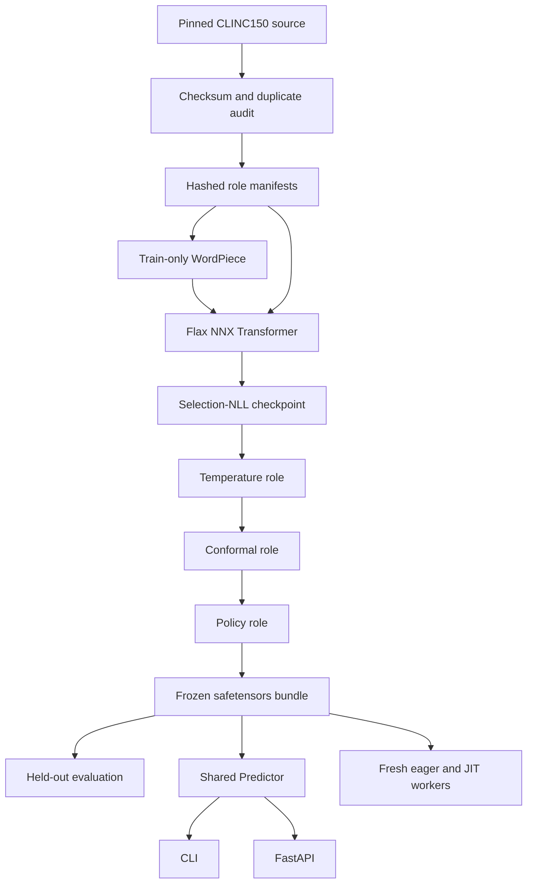

# Architecture

## Data and model flow

The baseline follows the same calibration and evaluation interfaces after producing logits from TF-IDF/logistic regression. It provides a strong alternative explanation for performance: short intent phrases may be sufficiently separable with lexical features.

## Encoder contract

Inputs are integer token IDs and an attention mask of shape `[batch, sequence]`. Learned token and position embeddings produce `[batch, sequence, 96]`. Each pre-norm block projects Q/K/V, forms four attention heads of width 24, masks padded keys, and applies attention and feed-forward residual updates. A final LayerNorm and masked mean pool produce one vector per request; a linear head produces `[batch, 150]` logits.

Key masking prevents real tokens from attending to padding. Masked pooling prevents padded output positions from changing the sentence representation. The model includes CLS/SEP tokens in that pool. Regression tests change padded token IDs and compare different padded sequence lengths to verify invariance, as well as comparing eager and compiled outputs.

For training, a fixed batch shape avoids a separate compilation for each partial final batch. Zero sample weights, rather than duplicated examples, remove padded rows from the objective. A regression compares the resulting update against an unpadded real batch. Dropout is disabled in this comparison so randomness does not obscure the invariant.

Serving rounds the real batch size up to one of 1, 8, or 32. All sequences have the model's fixed 32-token window. Each bucket is compiled during application startup, and only real rows are returned. Tokenization also measures original length so truncation is visible to the caller.

## Bundle ownership

The frozen bundle binds weights, model configuration, tokenizer files, label order, decision rule, and training protocol with SHA-256 hashes. `model.json` independently records the weights digest. Weight loading rejects unexpected parameter keys, mismatched shapes or dtypes, and nonfinite values. Safetensors avoids loading executable Python pickle payloads.

`verify_bundle` rejects artifacts outside the bundle directory and missing or changed files. The bundle's own digest identifies the specific artifact in API results. These are integrity checks, not a digital signature: an attacker able to replace the whole bundle could replace its manifest too. Obtain release artifacts from the intended repository and compare the published archive checksum.

The exporter packages only the verified inference files, manifest, model card, and notices. Training histories and datasets stay out of the archive. The primary and second-seed reports remain in Git as text evidence; binary weights are distributed through the release.

## HTTP boundary

The API delegates inference to the same `Predictor` used by the CLI. Pydantic rejects extra fields, non-string inputs, blank text, oversized batches, invalid lengths, and non-integer/out-of-range `top_k`. One lock permits a single model call; overlapping requests receive 503 and can retry. This bounds active computation, not the entire HTTP transport's body size or connection count.

The default listener is localhost, with one worker and access logs disabled. Application code does not retain request text. A public deployment would need transport size limits, authentication as appropriate, a bounded ingress queue, representative load tests, and observability designed for its privacy requirements. Those are outside the measured local service.

## Performance measurement

`benchmark.py` launches one fresh worker for each mode/batch. Workers load the same bundle and tokenized input, time a synchronized first call, and then synchronize each warm call with `jax.block_until_ready`. CPU affinity is assigned before JAX initialization. Logits are compared against the eager reference at matching batch size.

Each worker samples its own resident memory every 5 ms during the measured phase and records process CPU time. The model runs in one worker process with threads, so there is no inference child-process family to aggregate. Parent orchestration, tokenizer/loading costs, and HTTP transport are excluded. Raw warm samples are retained; the p95 from 20 calls is a descriptive sample statistic, not a latency service-level guarantee.

## Relevant upstream interfaces

- [Flax NNX basics](https://flax.readthedocs.io/en/latest/nnx_basics.html): module, variable, and transformation APIs.
- [NNX optimizer](https://flax.readthedocs.io/en/latest/api_reference/flax.nnx/training/optimizer.html): optimizer state and updates.
- [Transformers tokenizers](https://huggingface.co/docs/transformers/main_classes/tokenizer): fast tokenizer interface.
- [JAX installation](https://docs.jax.dev/en/latest/installation.html): supported backend installation routes. The committed lock is the CPU route used here.
